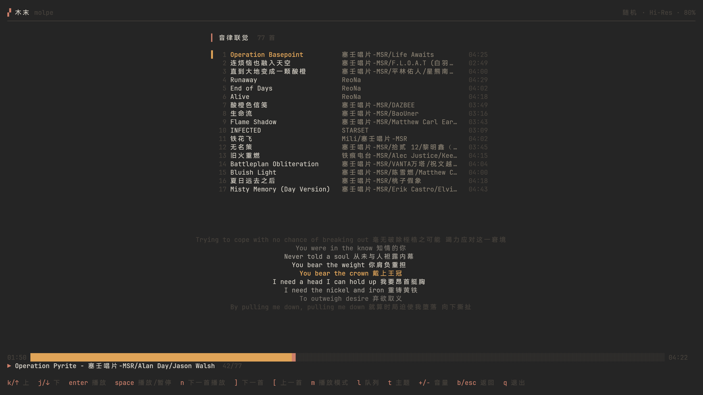

# 木末 Molpe

Linux 终端里的极简网易云音乐播放器。

功能克制、界面干净、跑起来不怎么吃电（大概。适合想在超轻本上一边苦逼当牛马一边听歌、又不想为此多背半首歌续航的人。



## 定位

- **极简**：只做登录、歌单、播放、队列这几件事，不试图复刻一个完整的网易云客户端（~~也复刻不动~~
- **轻量低功耗**：前后端分离——播放、队列、MPRIS 都在 `molpe daemon` 守护进程里，TUI 只是个显示终端，`Q` 一按界面消失、音乐照放，再敲 `molpe` 界面回来。守护进程稳态零周期定时器（歌词在下一句到来前才醒一次，进度条暂停即停，位置全靠锚点外推），耗的电基本就是 mpv 解码和网络。给超轻本的续航添砖加瓦（微小
- **队列逻辑花了心思**：历史严格按实际播放顺序记录、随机播放是每次都重新roll的真随机（不是把队列打乱一次然后循环播放那种"伪随机"），还带回避窗口不会刚听过又来一遍、"下一首播放"永远最高优先级、队列快照落盘、退出后重进恢复待播……用过一些播放器之后觉得这块值得认真做，于是认真做了。当然，逻辑是否符合每个人的直觉就不敢保证了（~~起码符合我自己的~~
- **仅适配 Linux 下的现代终端**：目前只在 **Arch Linux + kitty** 上实测过，其他环境的兼容性属于缘分

## 功能

- 终端二维码登录网易云账号（Cookie 本地持久化）
- 浏览自己创建与收藏的歌单
- 播放 / 暂停 / 上一首 / 下一首，顺序、列表循环、随机三种模式
- "下一首播放"队列，指定的歌拥有最高优先级
- Hi-Res 音质支持（走 EAPI，等级与实际文件一致）
- 滚动歌词（可带翻译）与自适应进度条
- 独立播放页，左侧自适应专辑封面及下方歌词，右侧当前播放歌单；封面异步加载并缓存
- 通过 MPRIS 接入桌面环境：KDE 媒体组件、媒体键均可控制
- 内置双主题，支持自定义配色（`~/.config/molpe/themes/*.json`）

## 安装

### AUR（推荐）

```sh
paru -S molpe-bin
```

预编译包，装完直接 `molpe` 启动。运行时依赖 `mpv`。

### 从源码构建

```sh
git clone https://github.com/Nk-YMZ/Molpe.git
cd Molpe
go build -o molpe .
```

需要 Go ≥ 1.27.1 与 mpv。

### macOS（本地测试包）

测试包适用于 Apple Silicon 与 macOS 26，构建产物为 `dist/macos-review-fixes/Molpe-1.3.0-mac.7-arm64.dmg`。
打开镜像后把 `Molpe.app` 拖入 Applications，再双击应用进入终端播放器。
包内包含 mpv 及所需动态库，后端会按需启动。`q` 完全退出，`Q` 保留后台播放。
配置与登录数据存放在 `~/Library/Application Support/Molpe`，缓存位于 `~/Library/Caches/Molpe`。
当前为临时签名的本机测试包，Developer ID 签名、公证、原生系统媒体键与 Control Center 集成待后续处理。
环境要求、分阶段方案与本机验证结果见 [macOS 兼容性评估](docs/MACOS.md)。

构建前准备 Go ≥ 1.27.1、Homebrew mpv、Python 3、Xcode 命令行工具和 macOS 26.5 SDK。
在仓库根目录执行以下命令。

```sh
python3 packaging/macos/build.py --go "$(command -v go)" --output dist/macos-review-fixes
```

可用 `--sdk` 指定本机可用的其他 SDK，最低部署目标为 macOS 26。

## 快捷键

| 按键 | 作用 |
| --- | --- |
| `j` / `k` / `↑` / `↓` | 移动光标 |
| `enter` | 进入歌单 / 播放歌曲 |
| `space` | 播放 / 暂停 |
| `]` / `[` | 下一首 / 上一首 |
| `n` | 加入"下一首播放" |
| `m` | 切换播放模式 |
| `l` | 播放队列弹窗 |
| `t` | 主题选择 |
| `a` | 音质选择，确认后立即保存并按原进度重新加载 |
| `v` | 打开当前播放页，再按一次返回浏览 |
| `+` / `-` | 音量 |
| `b` / `esc` | 返回 |
| `Q` | 转入后台（关闭界面，音乐继续，由桌面媒体组件控制） |
| `q` | 完全退出（停止播放） |

## 配置

选歌后自动进入独立播放页，左侧显示自适应专辑封面，下方显示滚动歌词，右侧显示当前播放歌单。
封面按窗口空间自适应，最多使用 96 列。色块模式每格以双颜色拟合 2×2 图像结构。
`b` / `esc` 返回此前的歌单浏览位置，`v` 再次进入播放页。窄窗口将歌词和列表纵向排列，
放大后自动恢复封面。关闭弹窗时复用已确认的终端图片。右侧用 `j/k` 或方向键选曲，回车播放，`n` 加入下一首播放，
播放标记与选择光标分别显示。加载失败时显示占位提示，可按 `r` 重试。

封面默认自动协商。实际查询确认 Kitty 图片传输、Unicode 图片占位符和真彩色支持后，
以 PNG 原生显示封面。Kitty 0.28+ 和 Ghostty 1.x 可用实际版本响应补足旧版能力查询。
原生图片等待确认时显示加载提示，能力不足、传输报错或超时时使用色块。tmux/screen 和强制兼容模式使用色块。
网易云 CDN 请求附带 `param=1024y1024`，封面加载失败时显示具体原因。
内存封面最大 1024×1024，最多缓存 8 张，图片通过终端直接传输，仅驻留内存。
在 Kitty/Ghostty 中可运行 `/Applications/Molpe.app/Contents/Resources/Player.command`。
双击 Molpe.app 使用系统 Terminal。需要强制色块时，在启动命令前设置 `MOLPE_COVER_MODE=blocks`。
本次接入 Kitty 图片协议，其他图片协议继续使用色块。

首次运行会在 `~/.config/molpe/config.json` 生成带说明的完整模板，主要包括：

- `quality`：音质（`standard` / `higher` / `exhigh` / `lossless` / `hires`）
- `lyric_lines`、`lyric_translation`：歌词行数与翻译开关
- `random_no_repeat`：随机播放回避最近 N 首
- `song_gap`：相邻两曲之间的静默间隔
- `theme`：主题名

音质显示会结合 mpv 的无损编码、解码格式和采样率校正，弹窗同时保留接口标记与解码参数。
高精度解码格式配合至少 48 kHz 时显示 Hi-Res。`s32` 保留 mpv 的格式名称。
歌词在跳转快照到达时立即校位，并在 mpv 恢复播放时使用实际位置重新对齐。

改完重启生效。

## 开发

仓库根目录的 `dev.sh` 用于在本机已安装正式版的情况下做开发测试，二者互不干扰：

```sh
./dev.sh        # 构建并启动隔离的开发实例；后端已在跑则直接重连
./dev.sh -r     # 强制重启后端（改了后端代码想立即生效时用）
./dev.sh --no-inherit  # 不复制正式版的配置、主题或登录 Cookie
```

它把 XDG 各目录指向 `/tmp/molpe-dev/`，socket、配置、Cookie、队列与正式版完全隔离，
并手动启动后端（绕过 systemd，不会拉起已安装的旧版）；首次运行会继承正式版的登录
Cookie、配置和自定义主题，删掉 `/tmp/molpe-dev` 即回到全新环境。
可用 `MOLPE_DEV_ROOT=/绝对路径 ./dev.sh --no-inherit` 指定另一套隔离目录。

后端脱离脚本独立存活，生命周期与正式版一致：TUI 里 `q` 完全退出、`Q` 转后台后重跑
`./dev.sh` 直接恢复界面。注意 MPRIS 总线名全用户唯一，两个实例同时跑时后启动的拿不到
媒体键控制。

## TODO

- [ ] 更多播放队列模式，以及对现有队列逻辑的持续打磨
- [ ] 多歌单拼接播放
- [ ] 更多自定义配置项

## 致谢

- [go-musicfox](https://github.com/go-musicfox/go-musicfox)：本项目的灵感来源，其 Go 版网易云 API 封装（[netease-music](https://github.com/go-musicfox/netease-music)）让这一切成为可能
- Kimi：感谢奋笔疾书，本项目的大量代码出自其手（~~作者主要负责提需求和验收~~

## License

MIT
